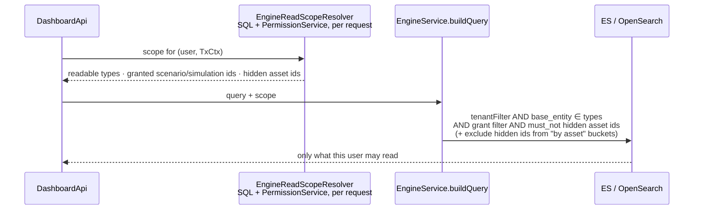
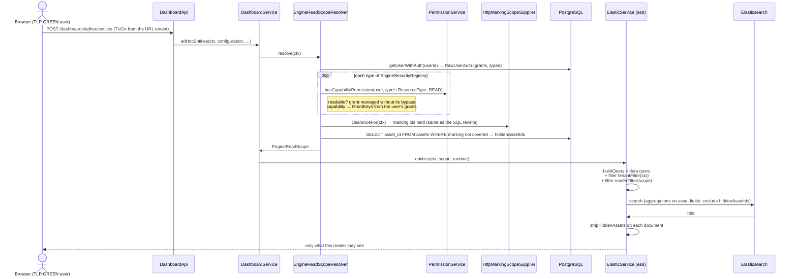

# Task 4 — Markings and dashboards (Elasticsearch / OpenSearch): brainstorming

**Status**: exploration, nothing implemented.

Dashboards do not read PostgreSQL: they read a search engine (Elasticsearch 8/9 or OpenSearch,
`engine.engine-selector`), fed by background jobs. Everything Task 3 / Task 4 built for markings is a
**SQL** mechanism (statement inspector + `is_marking_set_allowed`), so none of it reaches dashboards.

# Part 1 — How RBAC works today

## 1.1 The use case: Atomic testing without ACCESS_ASSETS

**Setup.** <br/>
User `amber` belongs to the group `Manager`, which carries the marking `TLP:AMBER`. <br/>
The role `Manager` was edited to remove `ACCESS_ASSETS`, `MANAGE_ASSETS` and `DELETE_ASSETS`, so Amber has no
asset capability. <br/>
Amber still reads atomic testings, through `ACCESS_ASSESSMENT` or a grant.


| Step | What Amber sees |
|---|---|
| Amber creates an atomic testing | The asset picker is empty: no asset can be added as a target. |
| An admin creates an atomic testing targeting a GREEN and a RED asset; Amber opens it | The atomic testing and the GREEN asset in its target list. The RED asset is hidden: marking filtering works. |
| Amber opens the same atomic testing to update it | 1/ in overview Amber can see the asset GREEN, RED is filtered<br/> 2/ when updating atomic testing, user does not see any asset in the form 🐞: the targets cannot be seen nor deleted nor edited |

**Why, in the code.** The detail view and the edit form read the assets through **two different
endpoints, checked against two different permissions.**

- **Detail view: the parent's permission.** =>
  `POST /api/injects/{injectId}/targets/ASSETS/search`  protected by
  `@AccessControl(resourceId = "#injectId", actionPerformed = READ, resourceType = INJECT)`. `INJECT` is
  in `RESOURCES_USING_PARENT_PERMISSION` (`PermissionService.java:60`), so `hasPermission` swaps it for
  its parent, `ATOMIC_TESTING` READ. `ACCESS_ASSETS` is never checked. The rows are read from
  PostgreSQL through the statement inspector, hence the RED asset is hidden.
- **Edit form: the catalogue's permission.** The form's asset list (`InjectEndpointsList.tsx`) loads the
  selected assets through an `EndpointContext`, implemented once per parent type:

## 1.2 RBAC implementation: the different options to make it consistent

**Option A: The capability also gates embedded assets. (this is not what is implemented atm)** Without `ACCESS_ASSETS`, no asset is shown
anywhere, including inside a scenario, a simulation or an atomic testing.

- ✅ One rule, easy to explain: no capability, no asset.
- ❌ A `Manager` without assets sees atomic testings with no target, and expectation results with no
  asset.
- ❌ Not local: every REST surface that embeds assets changes (targets, expectation results per asset,
  the endpoint column of the findings list, exports, attack paths), and dashboards too.

**Option B: The editor follows the parent. (this is the current implementation, with some UI inconsistencies/bugs)**

- ✅  An asset embedded in a resource the user reads is
  visible
- ✅ removable if the user may update that resource
- ❌ Adding a new asset searches the catalogue, so it still requires `ACCESS_ASSETS`


> [!NOTE]
> **This is how RBAC works today: Option B: The editor follows the parent.** A capability gates the
> **catalogue** (the Assets menu, the picker, `/api/endpoints/search`), not an asset **embedded** in a
> scenario, a simulation or an atomic testing. An embedded asset follows its parent's permission.

## 1.3 What Option B: The editor follows the parent gives Amber in the edit form

| Action | Endpoint | Allowed without `ACCESS_ASSETS`? |
|---|---|---|
| See the current assets | new `/api/atomic-testings/{id}/endpoints/find`, checked on `ATOMIC_TESTING` READ, returning only assets the inject references | ✅ |
| Remove an asset | this only edits the inject's id list, then saves through the update endpoint (`ATOMIC_TESTING` WRITE / `MANAGE_ASSESSMENT` or grant) | ✅ if she may edit the atomic testing |
| Add an asset | the picker (`EndpointsPicker`) searches the whole catalogue: `/api/endpoints/search` | ❌ stays `ACCESS_ASSETS`. The UI should hide or disable "Add" instead of opening an empty picker |
| Save the form | update endpoint, with the asset ids unchanged | ✅ |

> [!WARNING]
> 🐞 <b> UI Bugs: atomic testing does not follow Option B: The editor follows the parent.</b>
> - Adding an asset should not be offered without `ACCESS_ASSETS`: atm the "Add" button opens a picker
>   that gets a 403 and stays empty. It should be hidden or disabled with
>   `ability.can(ACTIONS.ACCESS, SUBJECTS.ASSETS)`.
> - Same shape for findings: the rows of an embedded findings list link to a detail page the user
>   cannot open. The link should be disabled without `ACCESS_FINDINGS`.

# Part 2 — How grants work today

A grant gives a **group** a role on **one** resource. It is the second way to reach a resource, next to
capabilities: a capability says "every scenario", a grant says "this scenario".

## 2.1 The model

Table `grants` (`Grant.java`):

| Column | Meaning |
|---|---|
| `grant_group` | the group holding the grant: every member gets it |
| `grant_resource` | the id of **one** resource (a plain string, no foreign key) |
| `grant_resource_type` | `SCENARIO`, `SIMULATION`, `ATOMIC_TESTING`, `THREAT_ARSENAL` (the grant is on an injector contract id), `AUTONOMOUS_RUN`; `PAYLOAD` is deprecated, `UNKNOWN` |
| `grant_name` | the role: `OBSERVER` < `PLANNER` < `LAUNCHER`. A higher role includes the lower ones (`GRANT_TYPE.andHigher()`) |

What each role allows:

| Role | Backend actions (`PermissionService.hasGrantPermission`) | Frontend actions on the `RESOURCE` subject (`parserRbac.ts`) |
|---|---|---|
| `OBSERVER` | `READ` | `ACCESS` |
| `PLANNER` | + `WRITE`, `DELETE` | + `MANAGE`, `DELETE` |
| `LAUNCHER` | + `LAUNCH` | + `LAUNCH` |

## 2.2 Who sets grants

- **By hand**: Settings › Groups › a group › Grants, one tab per type: scenarios, simulations, atomic
  testings, threat arsenals (`settings/groups/tenant_groups/grants/*`). API:
  `POST /api/groups/{groupId}/grants` and `DELETE /api/groups/{groupId}/grants/{grantId}`, checked on
  `USER_GROUP` WRITE, i.e. `MANAGE_TENANT_USERS_GROUPS_AND_ROLES`.
- **Copied by the platform**:
  - a simulation created from a scenario receives a **copy** of the scenario's grants
    (`ScenarioToExerciseService.java:106`). It is a copy at creation time, not an inheritance: a
    grant added to or removed from the scenario later does not change its existing simulations;
  - duplicating a scenario or a simulation copies its grants (`ScenarioService.java:1284`,
    `ExerciseService.java:589`);
  - relaunching an atomic testing moves its grants to the new inject (`AtomicTestingService.java:260`).
- **Not anymore**: group default grants (a grant given automatically on every new scenario or
  simulation) were removed by `V4_25__Remove_Default_Grants_Table`; the `DefaultGrant` class is a
  leftover with no use.

## 2.3 How one request is decided

`PermissionService.checkPermission`, in this order:

1. admin → allowed;
2. `BYPASS` of the matching scope (platform / tenant) → allowed;
3. a type that uses its parent's permission (inject, injector contract, objective, evaluation,
   workflow, step, condition, autonomous run) is replaced by its parent: an inject by its scenario,
   simulation or atomic testing, an injector contract by its threat arsenal. `READ` stays `READ`,
   `LAUNCH` stays `LAUNCH`, the rest becomes `WRITE`;
4. a grant-managed type with `SEARCH` → allowed, the list is filtered in the query (§2.4);
5. the user has **the capability** (e.g. `ACCESS_ASSESSMENT`) → allowed, on every resource of that
   type, without looking up any grant. Without the capability, go on;
6. a grant-managed type → **the grant**: allowed only if one of the user's groups has a grant on
   this resource id, with a role high enough (`GrantRepository.existsByUserIdAndResourceIdAndNameIn`).
   Example: no `ACCESS_ASSESSMENT`, an OBSERVER grant on scenario `S1` → `S1` is readable, the other
   scenarios are not;
7. an `/options` endpoint called with a `sourceId` → a grant on that `sourceId`;
8. otherwise → denied.

The capabilities that make grants irrelevant (step 5):

| Grant resource type | `READ` | `WRITE` | `LAUNCH` | `DELETE` |
|---|---|---|---|---|
| `SCENARIO`, `SIMULATION`, `ATOMIC_TESTING`, `AUTONOMOUS_RUN` | `ACCESS_ASSESSMENT` | `MANAGE_ASSESSMENT` | `LAUNCH_ASSESSMENT` | `DELETE_ASSESSMENT` |
| `THREAT_ARSENAL` | `ACCESS_THREAT_ARSENALS` | `MANAGE_THREAT_ARSENALS` | — | `DELETE_THREAT_ARSENALS` |

## 2.4 How lists are filtered

`SEARCH` is open on grant-managed types (step 4); each search adds
`SpecificationUtils.hasGrantAccess(userId, isAdminOrBypass, hasCapaForClass, grantType)`:

- admin, `BYPASS` or the capability → no filter;
- otherwise → `id IN (ids of the resources this user's groups are granted on, with a role ≥ grantType)`;
- for an **inject**: its own id **or** its scenario id **or** its simulation id. An inject is listed
  through the grant of its scenario or simulation, an atomic testing through its own.

It only applies to the `GrantableBase` entities: `Scenario`, `Exercise`, `Inject`, `Payload`,
`AutonomousRun`. Found in the scenario, atomic testing and inject searches and the full-text search
(`hasGrantAccess`), and in the payload and injector contract searches (`withGrantFilter`,
`accessibleResourcesSubquery`). *To check: how the simulation list applies grants.*

## 2.5 Frontend

The user's grants come with the user (resource id → role). `parseGrants` turns each role into actions
on the generic `RESOURCE` subject, keyed by the resource id; capabilities become their own subject
(`MANAGE_ASSESSMENT` → `MANAGE` on `ASSESSMENT`). Screens are expected to check both, as
`useScenarioPermissions` / `useSimulationPermissions` do:

```ts
ability.can(ACTIONS.MANAGE, SUBJECTS.RESOURCE, scenarioId) || ability.can(ACTIONS.MANAGE, SUBJECTS.ASSESSMENT)
```

> [!WARNING]
> 🐞 The Statistics tab checks the grant alone: "Select dashboard" is shown with
> `ability.can(MANAGE, RESOURCE, scenarioId)` (`ScenarioAnalysis.tsx:141,158`,
> `SimulationAnalysis.tsx:98,115`). A user with `MANAGE_ASSESSMENT` and no grant does not see it,
> while the backend accepts the save (`PUT /api/scenarios/{id}`, `SCENARIO` WRITE).

## 2.6 What grants do not cover

- **Only five types** are grant-managed. There is no grant on an asset, a finding, a team…: those are
  capability-only.
- **No inheritance**: a simulation gets a copy of its scenario's grants at creation (§2.2), and an
  inject or a workflow follows its parent's permission (§2.3, step 3).
- **Dashboards ignore grants**: the engine filter that used them is commented out (§3.5); §4.4
  describes how to bring them back, typed per resource.

# Part 3 — How dashboards work today

## 3.1 Where dashboards stand against Option B: The editor follows the parent

Part 1 showed that the REST API follows Option B: The editor follows the parent (except the atomic
testing bug). Dashboards on `main` do not follow it: they are not "assets visible through the
parent", they are "no RBAC at all". Every `DashboardApi` endpoint only checks `ResourceType.DASHBOARD`
(the widget's dashboard, or dashboard search), and the engine only adds `tenantFilter(ctx)` (§3.4).

| What the user reads | REST API (Option B: The editor follows the parent) | Dashboards on `main` |
|---|---|---|
| Asset catalogue: the endpoint index, an "entities" widget on endpoints, search hits on assets | `/api/endpoints/search` requires `ACCESS_ASSETS` | ✅ visible to anyone with dashboard access: **wider than Option B** |
| Assets embedded in a parent the user reads (`base_assets_side` of a simulation, "findings per endpoint" of a readable simulation) | ✅ visible, parent's permission | ✅ visible: consistent with Option B, only because nothing is checked |
| The parent itself (a scenario or simulation without grant and without `ACCESS_ASSESSMENT`) | ❌ hidden | ✅ visible: **wider than Option B** |
| A RED asset (marking) | ❌ hidden | ✅ visible: **leak** |

## 3.2 Sync: PostgreSQL → search engine

- `EngineSyncExecutionJob` registers one job per model every **15 s** to sync each of the 15 entities.
- 15 model entities to the synced entities: `asset`, `asset-group`,
      `attack-pattern`, domain, finding, inject, expectation-inject, scenario, simulation,
      security-platform, tag, team, vulnerable-endpoint, plus two snapshot observation models behind the
      `BULK_SNAPSHOT_EXPORT` dev feature.

**Latency.** Create/update: typically 1-17 s.

## 3.3 Data model

Fields shared by every document (`EsBase`, `EsTenantBase`):

<table>
  <thead>
    <tr><th>Field</th><th>Meaning</th></tr>
  </thead>
  <tbody>
    <tr><td><code>base_id</code>, <code>base_entity</code></td><td>id, document type (= index name)</td></tr>
    <tr><td><code>base_representative</code></td><td>display label (asset name, scenario name…)</td></tr>
    <tr><td><code>base_created_at</code>, <code>base_updated_at</code></td><td>timestamps (<code>base_updated_at</code> = effective updated_at)</td></tr>
    <tr style="background-color: rgba(40, 167, 69, 0.15);"><td><code>base_tenant_side</code></td><td><b>tenant id</b>, on every document</td></tr>
    <tr style="background-color: rgba(220, 53, 69, 0.15);"><td><code>base_restrictions</code></td><td>grant ACL ids (scenario / simulation / own id); written but not used, see 3.5</td></tr>
    <tr><td><code>base_dependencies</code></td><td>ids whose deletion deletes this document</td></tr>
  </tbody>
</table>


**No marking is indexed today.** `assets.marking_ids` is not selected by the asset indexing query
(`AssetRepository.java:112-123`), and no `Es*` class has a marking field.

## 3.4 How tenant isolation filtering was done (the precedent)

Multi-tenancy had the same problem as markings: every document of every type must be filtered for
the reader. It was solved in two moves:

1. **Denormalize the scope onto every document.** Every `Es*` extends `EsTenantBase`, whose
   `base_tenant_side` is filled by each handler from the row's `tenant_id`.
2. **One central filter on every read.** Every query of the three engines goes through the private
   `buildQuery` (`ElasticService.java:301-339`), which always adds `tenantFilter(ctx)`
   (`ElasticService.java:357-378`), built from the request's `TxCtx`:

## 3.5 No per-user filtering exists today for GRANT or CAPABILITY

**Per-user filtering does not exist today.** `buildQueryRestrictions(user)` (grants on
`base_restrictions`) is commented out in `buildQuery`,  ([`6f5609722`](https://github.com/OpenAEV-Platform/openaev/commit/6f5609722728ad2dc992da228bd4d3cd1c496a92), Hedi Tarchouni, 2025-09-24).
(`searchCursorPaged`) still applies it. 

> A bit of History of `buildQueryRestrictions` (why per-user filtering disappeared)
> 
> - **2021-12-19** — `bdb66c492` (Julien Richard): **Grants** exist from the original backend: a group is granted on a scenario or a simulation. At that time, access is "admin, or a grant".
> - **2025-04-23** — [`a6b967c06`](https://github.com/OpenAEV-Platform/openaev/commit/a6b967c06) (Romuald Lemesle, Custom Dashboards): The engine gets `base_restrictions` and `buildQueryRestrictions`: a non-admin sees a document only if its `base_restrictions` contains a scenario or simulation they have a **grant** on, or if it has no restriction. **Intent: dashboards mirror the grant model, the only access model then.**
> - **2025-06 → 2025-08** — `7bee25072`, `8f04f2606`, `6caf0555a` (Hedi Tarchouni, #375): **RBAC**: roles and capabilities. A capability such as `ACCESS_ASSESSMENT` gives access to every scenario and simulation **without any grant**.
> - **2025-09-24** — [`6f5609722`](https://github.com/OpenAEV-Platform/openaev/commit/6f5609722728ad2dc992da228bd4d3cd1c496a92) (Hedi Tarchouni, #375): The filter is commented out: "issue/3768 will refactor this logic to have restriction based on markings". No reason in the commit.
> - **2026-10-05** — `78d284bf1` (Alexandre Gaspard, OpenGRC snapshot export): The filter is re-enabled **for the snapshot export only**, and skipped for admin, BYPASS and `ACCESS_ASSESSMENT` (`SnapshotObservationService.grantFilter`).

**Why it was removed (inferred from the code, to confirm with Hedi):** the filter only knew grants, and
RBAC broke its assumptions:

- a user with the `ACCESS_ASSESSMENT` capability but no grant sees every scenario in the REST API, yet
  would have seen **empty dashboards**;
- assets, asset groups, tags, teams and domains were indexed with **their own id** in
  `base_restrictions` (`EndpointHandler`, `AssetGroupHandler` at `6f5609722^`). Nobody holds a grant on
  an asset id, so every non-admin saw **none** of them.

The snapshot export re-enabled it in 2026 with exactly the missing piece, the capability bypass, which
supports this reading.

# Part 4 — Exploring one approach: Resolve filtering thro SQL, pass filtered ids to ES

## 4.1 Requirements

Part 3 showed that dashboards apply **no per-user filtering at all**: no capability check per document
type, no grant, no marking. Filtering on markings alone would leave the two other holes open, so
the dashboard filter has to cover **three dimensions**, the same ones the REST API enforces:

| Dimension | REST API today | Question for each indexed document |
|---|---|---|
| **Capability** (RBAC) | `@AccessControl` per resource type | may this user read this *type* (asset, finding, scenario…)? |
| **Grant** | `RESOURCES_MANAGED_BY_GRANTS` (scenario, simulation, atomic testing) | does the user have a grant on the scenario / simulation this document belongs to (unless a capability such as `ACCESS_ASSESSMENT` covers all)? |
| **Marking** | statement inspector + derived tables | is every asset this document is about within the user's clearance? |

The same three dimensions apply to every dashboard read, including a dashboard shown inside a
scenario or a simulation (§4.5): there is no context-dependent rule.

And three constraints on *how*:

1. **Security state changes often** (a marking, a group, a grant, a role). Anything stored in the
   documents is only corrected by the next sync: 15 s at best, minutes under load, and a full reindex
   for some changes. During that window the dashboard shows what the REST API already hides.
2. **The index is history.** Findings, expectations and vulnerable endpoints of past simulations stay
   in the index. When an asset becomes RED, the REST API hides its history instantly; the index must
   do the same for the documents already there, not only for new ones.
3. **No second copy of the rules.** Capabilities, grants and markings are already decided by
   `PermissionService` and SQL. Re-implementing them in ES queries means two implementations to keep
   identical, in three engines.

## 4.2 The approach

**Principle.** Store in the index only what does not change with security: **ids of relationships**
(an expectation's asset, a finding's assets, an inject's simulation). They are already there
(`base_asset_side`, `base_endpoint_side`, `vulnerable_endpoint_id`, `base_scenario_side`,
`base_simulation_side`…). At each read, ask **SQL and `PermissionService`** — the single source of
truth — what the user may not see, and add it to the ES query as plain id filters next to
`tenantFilter`:



How each dimension is resolved, reusing what exists:

| Dimension | Resolved in SQL / Java (source of truth) | Applied in ES |
|---|---|---|
| **Capability** | for each index, its `ResourceType` (asset → `ASSET`, finding → `FINDING`, security-platform → `SECURITY_PLATFORM`…), checked with `PermissionService` / `Capability` READ | `terms(base_entity, readable types)` |
| **Grant** | generic, per indexed type (§4.4): for a type managed by grants, `PermissionService` first checks the capability that makes grants irrelevant (e.g. `ACCESS_ASSESSMENT` for scenarios and simulations); without it, the user's grants of the matching `GRANT_RESOURCE_TYPE` (from `RawUserAuth`, already loaded) | on the fields the registry declares as grant keys for that type (today `base_scenario_side`, `base_simulation_side`, `base_id`, `base_inject_side`), within the granted ids; a document with none of these fields set is not grant-filtered. Types not managed by grants (assets, tags, teams…) are only filtered by capability: OpenAEV has no grant on an asset today. Supporting one later is a registry entry, not new code |
| **Marking** | `SELECT asset_id FROM assets WHERE marking_ids <> '{}' AND NOT is_marking_set_allowed(marking_ids)` under the user's clearance: **the same SQL function** as the REST API, so no copy of the rule | `must_not terms` on the asset reference of each type (asset: `base_id`; expectation, observations: `base_asset_side`; finding: `base_endpoint_side`; vulnerable-endpoint: `vulnerable_endpoint_id`); aggregations on `base_assets_side` & co get `exclude: <hidden ids>`; the same ids are stripped from `*_side` arrays of returned documents |

**Against the three constraints**

1. **No lag.** Nothing security-related is in the index. A marking, grant or role change is visible on
   the next dashboard request (or on cache eviction, which already exists for clearance
   and memberships).
2. **History is covered.** Old findings and expectations reference the asset by id, and ids never
   change: the moment `ASSET_RED` is hidden, its whole history is filtered, like in the REST API.
3. **One copy of the rules.** The decision stays in `PermissionService` and `is_marking_set_allowed`.
   ES only receives id lists. What remains to maintain is the mapping "index → resource type" and
   "index → field holding the asset / scenario / simulation reference": a small registry, the
   counterpart of `MarkingDerivedTables`, with a test that every `Es*` class is listed.

**Costs and limits**

- **One extra SQL query per dashboard request** (the hidden asset ids), on the marked assets only
  (`marking_ids` has a GIN index). Cacheable per (user, tenant), evicted when an asset's markings or
  the user's clearance change.
- **Deny-list size.** ES caps a `terms` query at 65 536 values by default (`index.max_terms_count`).
  The hidden list is the user's *restricted* assets, normally a minority. Above a threshold, fail
  closed (hide the asset-related types for that user).
- **Multi-asset findings.** A deny-list hides a finding as soon as one of its assets is hidden (strict).
  The SQL rule is permissive ("visible if at least one visible asset"). Either accept strict in
  dashboards, or filter findings with the *allowed* list instead.
- **Three engines** (es8, es9, OpenSearch): the filters are written three times, like `tenantFilter`.
- **Where the scope is applied**: in `buildQuery` (documents), in every terms aggregation on an
  asset-id field (buckets), in `resolveIdsRepresentative` (labels), and on returned documents (the
  `*_side` arrays). Missing one leaks the id.

**Effort: M.** No index change, no reindex, no handler change. A resolver service with its cache, the
registry, the filters in three engines, and tests mirroring the tenant ones (plus one per dimension).

## 4.3 Classes: `EngineReadScopeResolver`, `EngineReadScope` vs `RawUserAuth`

### What changes in the engine's contract

Before, every engine read received the **user** (`RawUserAuth`): raw facts (admin flag, grants) that
the engine would have had to interpret itself. It received them but used nothing (the grant filter
was commented out). Now it receives the **decision** (`EngineReadScope`): what this reader may read,
already resolved from the source of truth. The engine only turns it into id filters.

| | `RawUserAuth` (before) | `EngineReadScope` (now) |
|---|---|---|
| What it is | facts about the user: `user_admin`, `user_grants` | what the reader may read, per indexed type |
| Who interprets it | the engine (`buildQueryRestrictions`, off since 2025) | the resolver, with `PermissionService` and the SQL clearance |
| Capabilities | not carried | `readableEntities` |
| Grants | raw, untyped list of resource ids | `grantFilters`: per type, the fields to match and the granted ids |
| Markings | not carried | `hiddenAssetIds` |
| Still used for | the snapshot export of es9 / OpenSearch until they are ported (`legacyGrantUser`) | every read of es8 |

### The scope object, on an example

A user with `ACCESS_DASHBOARDS`, `ACCESS_ASSETS` and `ACCESS_FINDINGS`, **without** `ACCESS_ASSESSMENT`,
whose group is granted on scenario `S1`, cleared `TLP:GREEN`. Asset `A-RED` is marked `TLP:RED`.

```text
EngineReadScope(
  unrestricted     = false,
  readableEntities = [asset, asset-group, tag, team, domain, attack-pattern,
                      scenario, simulation, inject, expectation-inject, finding, vulnerable-endpoint],
                     # no security-platform (no ACCESS_SECURITY_PLATFORMS), no snapshot observations
  grantFilters     = {
    scenario:           [GrantKey(base_id,              {S1})],
    simulation:         [GrantKey(base_id,              {S1's simulations created after the grant}),
                         GrantKey(base_scenario_side, {S1})],   # grants copied at creation, §2.2
    inject:             [GrantKey(base_scenario_side,   {S1}), GrantKey(base_simulation_side, {}),
                         GrantKey(base_id,              {})],   # atomic testing
    expectation-inject: [... same keys, base_inject_side for atomic testing ...],
    finding:            [... same keys ...],
    vulnerable-endpoint:[GrantKey(base_scenario_side, {S1}), GrantKey(base_simulation_side, {})]
  },
  hiddenAssetIds   = {A-RED},
  legacyGrantUser  = <the user's RawUserAuth>   # used by es9 / OpenSearch only
)
```

An admin gets `EngineReadScope.unrestricted(…)`: no per-user filter at all. A user holding every
capability, with no hidden asset, gets the same.

### How it reaches the query



`readerFilter(scope)` builds one clause per readable type, OR-ed together. A document of a type the
reader cannot read matches no clause, so it is excluded:

```text
bool.filter:
  tenantFilter(ctx)                                    # unchanged since #8162
  bool.should (minimum_should_match = 1):              # readerFilter(scope)
    - base_entity = asset    AND NOT base_id            ∈ {A-RED}
    - base_entity = finding  AND (base_scenario_side ∈ {S1} OR … OR no grant-key field)
                             AND NOT base_endpoint_side ∈ {A-RED}
    - base_entity = scenario AND (base_id ∈ {S1} OR no grant-key field)
    - base_entity = tag                                  # open type: no condition
    - …                                                  # one clause per readable type
bool.must:
  the widget's own filters (unchanged)
```

## 4.4 The grant dimension in detail: generic, not scenario-only

The only grant filter that runs today, the snapshot export (`SnapshotObservationService.grantFilter`,
[`78d284bf1`](https://github.com/OpenAEV-Platform/openaev/commit/78d284bf1bce03e4010d50ddb827b032773f5bb2)),
cannot be reused as is:

- its bypass is hard-coded to `ACCESS_ASSESSMENT`, the capability of scenarios and simulations only,
  while grants also exist for atomic testings and threat arsenals (`RESOURCES_MANAGED_BY_GRANTS`);
- it matches `base_restrictions`, one untyped list that each handler fills differently:

| Index | `base_restrictions` today | Problem |
|---|---|---|
| asset, asset-group, tag, team, domain, security-platform, vulnerable-endpoint | their own id | not a grant key: hides them from every non-admin |
| scenario | scenario id | ok |
| simulation | simulation + scenario ids | ok |
| inject | scenario + simulation ids | an atomic testing inject has neither → `null` → visible to everyone |
| expectation-inject | simulation + inject id | no scenario id; the inject id matches an atomic testing grant by coincidence |
| finding | scenario id only | a grant on the simulation is ignored; atomic testing findings unrestricted |
| snapshot observations | scenario + simulation ids | ok for this use |
| — | no threat arsenal id anywhere | threat arsenal grants cannot apply |

**Generic version.** A registry per index, next to the marking one:

- the **`ResourceType`** that gates reading it (asset → `ASSET`, finding → `FINDING`, inject → the
  type of its parent…);
- its **typed grant keys**: which already-indexed field holds which grantable resource (inject:
  `base_scenario_side` → SCENARIO, `base_simulation_side` → SIMULATION, `base_id` → ATOMIC_TESTING
  for an atomic testing…).

At query time, per index, `PermissionService`'s own rule decides, instead of a copy of it:

1. the user has the capability for that type (admin, BYPASS, `ACCESS_ASSESSMENT`, and any future
   capability) → no grant filter;
2. else, the type is grant-managed → `grant key field ∈ ids of the user's grants of that resource type`;
3. else → the index is excluded for this user.

Reads run on the `openaev_*` wildcard, so the per-index conditions combine as
`(base_entity = X AND filter_X) OR (base_entity = Y AND filter_Y) …`, next to `tenantFilter` and the
marking filter. A new grantable resource is then one registry entry, and `base_restrictions` can be
retired instead of fixed handler by handler.

## 4.5 Embedded dashboards: any dashboard shown inside a scenario or a simulation

**Status**: proposal, matches the POC as it is.

### What the UI allows today

- The **Statistics** tab of a scenario (or a simulation) shows `scenario_custom_dashboard`
  (`exercise_custom_dashboard`), else the tenant default `platform_scenario_dashboard`
  (`ScenarioAnalysis.tsx:128`).
- A user who can manage the scenario (`canChooseDashboard = ability.can(MANAGE, RESOURCE, scenarioId)`)
  picks **any** custom dashboard with "Select dashboard" (`SelectDashboardButton`). Nothing requires it
  to be a scenario dashboard: it can be an asset dashboard, with an "entities" widget listing the
  endpoints, a posture per asset…
- Its widgets are then served by `/api/scenarios/{scenarioId}/dashboard/*` (#2 in §3.1), checked on
  `SCENARIO` READ only.
- The widgets are tied to the scenario **only through the dashboard parameters, filled by the
  browser** (`paramsBuilder`, `ScenarioAnalysis.tsx:92`): a `scenario` parameter receives `scenarioId`
  (hidden), a `simulation` parameter defaults to the last ended simulation and can be changed. A
  widget that uses no parameter is not scoped at all.

What a reader of scenario `S1` sees in its Statistics tab when an asset dashboard is attached:

| Widget of the attached dashboard | `main` today | Proposed: the POC rule, the same as everywhere |
|---|---|---|
| "Endpoints" list (endpoint index, no parameter) | the whole asset catalogue of the tenant, for anyone who reads `S1` | requires `ACCESS_ASSETS` |
| "Findings" list | every finding of the tenant | requires `ACCESS_FINDINGS`, then the reader's grants |
| "Expectations by asset", filtered on the `scenario` parameter | `S1`'s expectations, with the asset names | `S1`'s expectations (the reader may read `S1`); the asset names only with `ACCESS_ASSETS` |
| "Expectations by asset", with no parameter | every expectation of the tenant | the expectations the reader may read (`ACCESS_ASSESSMENT` or a grant), as on a custom dashboard |
| Any widget, with the `simulation` parameter changed to a simulation of scenario `S2` | `S2`'s data (🐞 §3.1) | only if the reader may read `S2` |

### The proposal: one rule for every dashboard

A dashboard embedded in a scenario or a simulation is filtered **exactly like any other dashboard
read**: capability per indexed type, then grants, then markings (§4.2 to §4.4). There is no parent
context and no second rule: the scenario only decides **which** dashboard is displayed, never what
its widgets may return.

- **Why.** Any dashboard can be attached to a scenario, so "embedded" says nothing about the data a
  widget reads: an asset dashboard in a Statistics tab is still the asset catalogue. A rule that
  depends on where the dashboard is opened would give two answers for the same widget, and would have
  to decide, document by document, what "belongs" to the scenario.
- **Assets are always filtered.** Without `ACCESS_ASSETS`, no asset document is returned, in an
  embedded dashboard as on a custom one. Asset ids found in documents the reader may read
  (an expectation's `base_asset_side`) stay, but their names are resolved through the same reader
  filter, so they are not resolved without `ACCESS_ASSETS`.
- **The #2 parameter bug of §3.1 closes on its own.** Every document is checked against the reader's
  own capabilities and grants, whatever the widget parameters say: a simulation of `S2` is only
  returned if the reader may read `S2`.
- **Nothing to add to the POC.** `/api/scenarios/{id}/dashboard/*` and `/api/exercises/{id}/dashboard/*`
  call the same `DashboardService` methods as custom dashboards, which already resolve the reader's
  `EngineReadScope`. `isWidgetInResourceDashboard` stays: it only checks that the widget belongs to
  the dashboard attached to that resource.
- **Known difference with the REST API.** The REST API follows Option B: The editor follows the
  parent (a simulation's target list shows its assets without `ACCESS_ASSETS`). The Statistics tab
  does not: it is analytics over the index, filtered like the rest of the dashboards.

> [!IMPORTANT]
> **To decide with Soumaya**
> - Should "Select dashboard" in a scenario or a simulation only offer dashboards that have a
>   `scenario` or `simulation` parameter? Otherwise a catalogue dashboard can be shown inside a
>   scenario: correctly filtered, but confusing.
> - Without `ACCESS_ASSETS`, what does an asset breakdown ("expectations by asset") show? The POC
>   keeps the buckets with the raw asset id and no name; the alternative is to drop the asset buckets
>   and show "requires access to assets".
> - Do we accept that the Statistics tab differs from the REST API on assets (Option B: The editor
>   follows the parent in the REST API, the dashboard rule in the Statistics tab)?

## 4.6 The sync lag: what can be stale

PostgreSQL is the source of truth; the index follows it with a lag (§3.2: about 15 s, minutes under
load). The ids match by construction: each document's `base_id` (and its Elasticsearch `_id`) is the
row's id, and the `*_side` fields hold PostgreSQL ids. Two types have a composite `base_id`
(`vulnerable-endpoint`: `assetId_simulationId`; snapshot observations: an md5 of the grain), which is
why the registry filters them on another field (`vulnerable_endpoint_id`, `base_asset_side`).

The approach splits what can lag:

- **Security state is read from PostgreSQL on every request** (capabilities, grants, clearance, the
  hidden asset ids): a change applies on the next read, for documents already indexed too.
- **Relationships come from the index** (which asset a finding is about, which scenario an inject
  belongs to): they can be one sync behind.

| Case | Effect during the lag | Severity |
|---|---|---|
| An asset becomes `TLP:RED` | Hidden immediately: its id is in the hidden list on the next read, history of past simulations included | none |
| A new `TLP:RED` asset, not indexed yet | Nothing to show yet; once indexed, it is already in the hidden list | none |
| A grant or a role is removed | Immediate | none |
| An inject's targets change (RED added) | The index still shows the old targets: RED's id appears in the inject only after the next sync, and is then stripped | none (missing, never leaked) |
| A finding gets linked to a RED asset after its creation | The finding stays visible until its document is re-indexed with RED among its assets | **small window** |
| An entity is deleted in PostgreSQL | The delete is pushed after commit (replayed within 60 s if it fails); a deleted RED asset is no longer in the hidden list, so documents still referencing it are visible until the delete reaches them | **small window** |

The residual risk is limited to **relationships edited after creation**, for at most one sync. Most
links never change once written (an expectation's asset, a document's scenario or simulation).
Storing the security state itself in the index would instead make **every** marking, grant or role
change wait for a re-index.
