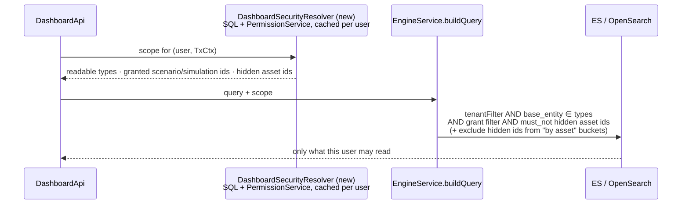

# Task 4 — Markings and dashboards (Elasticsearch / OpenSearch): brainstorming

**Status**: exploration, nothing implemented.

Dashboards do not read PostgreSQL: they read a search engine (Elasticsearch 8/9 or OpenSearch,
`engine.engine-selector`), fed by background jobs. Everything Task 3 / Task 4 built for markings is a
**SQL** mechanism (statement inspector + `is_marking_set_allowed`), so none of it reaches dashboards.

# Part 1 — How dashboards work today

## 1.1 Sync: PostgreSQL → search engine

- `EngineSyncExecutionJob` registers one job per model every **15 s** to sync each of the 15 entities.
- 15 model entities to the synced entities: `asset`, `asset-group`,
      `attack-pattern`, domain, finding, inject, expectation-inject, scenario, simulation,
      security-platform, tag, team, vulnerable-endpoint, plus two snapshot observation models behind the
      `BULK_SNAPSHOT_EXPORT` dev feature.

**Latency.** Create/update: typically 1-17 s.

## 1.2 Data model

Fields shared by every document (`EsBase`, `EsTenantBase`):

<table>
  <thead>
    <tr><th>Field</th><th>Meaning</th></tr>
  </thead>
  <tbody>
    <tr><td><code>base_id</code>, <code>base_entity</code></td><td>id, document type (= index name)</td></tr>
    <tr><td><code>base_representative</code></td><td>display label (asset name, scenario name…)</td></tr>
    <tr><td><code>base_created_at</code>, <code>base_updated_at</code></td><td>timestamps (<code>base_updated_at</code> = effective updated_at)</td></tr>
    <tr style="background-color: #d4edda; color: #155724;"><td><code>base_tenant_side</code></td><td><b>tenant id</b>, on every document</td></tr>
    <tr style="background-color: #f8d7da; color: #721c24;"><td><code>base_restrictions</code></td><td>grant ACL ids (scenario / simulation / own id); written but not used, see 1.3</td></tr>
    <tr><td><code>base_dependencies</code></td><td>ids whose deletion deletes this document</td></tr>
  </tbody>
</table>

**No marking is indexed today.** `assets.marking_ids` is not selected by the asset indexing query
(`AssetRepository.java:112-123`), and no `Es*` class has a marking field.

## 1.3 How tenant isolation filtering was done (the precedent)

Multi-tenancy had the same problem as markings: every document of every type must be filtered for
the reader. It was solved in two moves:

1. **Denormalize the scope onto every document.** Every `Es*` extends `EsTenantBase`, whose
   `base_tenant_side` is filled by each handler from the row's `tenant_id`.
2. **One central filter on every read.** Every query of the three engines goes through the private
   `buildQuery` (`ElasticService.java:301-339`), which always adds `tenantFilter(ctx)`
   (`ElasticService.java:357-378`), built from the request's `TxCtx`:

## 1.4 No per-user filtering exists today for GRANT or CAPABILITY

**Per-user filtering does not exist today.** `buildQueryRestrictions(user)` (grants on
`base_restrictions`) is commented out in `buildQuery`,  ([`6f5609722`](https://github.com/OpenAEV-Platform/openaev/commit/6f5609722728ad2dc992da228bd4d3cd1c496a92), Hedi Tarchouni, 2025-09-24).
(`searchCursorPaged`) still applies it. 

🔥 So anyone allowed on a dashboard endpoint sees <b>all data of the tenant</b>.   
🔥 <b>If I am a user with no <code>ACCESS_ASSETS capability</code> but with <code>ACCESS_DASHBOARD</code>, I can see the asset entity thro the dashboard API.</b>
  <b>Question to Soumaya:</b> is it something we also want to address?

> A bit of History of `buildQueryRestrictions` (why per-user filtering disappeared)
> 
> - **2021-12-19** — `bdb66c492` (Julien Richard): **Grants** exist from the original backend: a group is granted on a scenario or a simulation. At that time, access is "admin, or a grant".
> - **2025-04-23** — [`a6b967c06`](https://github.com/OpenAEV-Platform/openaev/commit/a6b967c06) (Romuald Lemesle, Custom Dashboards): The engine gets `base_restrictions` and `buildQueryRestrictions`: a non-admin sees a document only if its `base_restrictions` contains a scenario or simulation they have a **grant** on, or if it has no restriction. **Intent: dashboards mirror the grant model, the only access model then.**
> - **2025-06 → 2025-08** — `7bee25072`, `8f04f2606`, `6caf0555a` (Hedi Tarchouni, #375): **RBAC**: roles and capabilities. A capability such as `ACCESS_ASSESSMENT` gives access to every scenario and simulation **without any grant**.
> - **2025-09-24** — [`6f5609722`](https://github.com/OpenAEV-Platform/openaev/commit/6f5609722728ad2dc992da228bd4d3cd1c496a92) (Hedi Tarchouni, #375): The filter is commented out: "issue/3768 will refactor this logic to have restriction based on markings". No reason in the commit.
> - **2026-10-05** — `78d284bf1` (Alexandre Gaspard, OpenGRC snapshot export): The filter is re-enabled **for the snapshot export only**, and skipped for admin, BYPASS and `ACCESS_ASSESSMENT` (`SnapshotObservationService.grantFilter`).

**Why it was removed (inferred from the code, to confirm with Hedi):** the filter only knew grants, and
RBAC broke its assumptions:

- a user with the `ACCESS_ASSESSMENT` capability but no grant sees every scenario in the REST API, yet
  would have seen **empty dashboards**;
- assets, asset groups, tags, teams and domains were indexed with **their own id** in
  `base_restrictions` (`EndpointHandler`, `AssetGroupHandler` at `6f5609722^`). Nobody holds a grant on
  an asset id, so every non-admin saw **none** of them.

The snapshot export re-enabled it in 2026 with exactly the missing piece, the capability bypass, which
supports this reading.

# Part 2 — Requirements to validate with Soumaya

<b>Question to Soumaya: what do we want to cover?</b> Today dashboards filter by tenant only (Part 1),
so none of the requirements below holds. Tick the ones we keep: markings only, or markings, grants
and capabilities.

**Scope.** Every read of the search engine: custom dashboards, the home dashboard, scenario and
simulation dashboards, the screens built on `/dashboards/adhoc/*` (expectation lists, security
platform detail, reporting, results explorer), ATT&CK coverage, dashboard search, attack paths and
the snapshot export.

### Markings

*Example: a user cleared `TLP:GREEN`, an asset `ASSET_RED` marked `TLP:RED`.*

- [ ] **M1** The user does not see `ASSET_RED` itself: no name, hostname, IP or MAC address, in any
  list, count or label.
- [ ] **M2** The user does not see what was derived from `ASSET_RED`: its findings, expectations,
  vulnerable endpoints and observations, nor their weight in counts and scores.
- [ ] **M3** Injects, scenarios and simulations targeting `ASSET_RED` stay visible (Option 1: the
  parent stays visible), but `ASSET_RED` never appears in their target lists or "by asset"
  breakdowns.
- [ ] **M4** A finding on both `ASSET_GREEN` and `ASSET_RED` is: ☐ visible, as in the REST API ("at
  least one visible asset") ☐ hidden (strict). *To decide.*
- [ ] **M5** When an asset becomes `TLP:RED`, its data disappears from dashboards **immediately**, as
  in the REST API, including the history of past simulations.
- [ ] **M6** When the user loses a clearance (group or marking change), same: immediately.
- [ ] **M7** A user cleared `TLP:RED`, an admin or a BYPASS user sees everything.

### Grants

*Example: a user without `ACCESS_ASSESSMENT`, whose group is granted on scenario `S1` only.*

- [ ] **G1** The user sees `S1`, its simulations and their data (injects, expectations, findings,
  vulnerable endpoints), and nothing of the other scenarios and simulations.
- [ ] **G2** Same for atomic testings: only those the user is granted on.
- [ ] **G3** Threat arsenal grants also apply to dashboards. *To decide: is threat arsenal data
  shown in dashboards at all?*
- [ ] **G4** A user with `ACCESS_ASSESSMENT`, an admin or a BYPASS user sees every scenario and
  simulation, as in the REST API.
- [ ] **G5** A grant added or removed applies **immediately**.

### Capabilities (RBAC)

*Example: a user with `ACCESS_DASHBOARDS` and without `ACCESS_ASSETS`.*

- [ ] **C1** The user receives no asset data from dashboards: no asset documents, no asset names as
  labels.
- [ ] **C2** The same rule per type: findings need `ACCESS_FINDINGS`, security platforms
  `ACCESS_SECURITY_PLATFORMS`… *To write: the capability required by each index (§1.2).*
- [ ] **C3** `ACCESS_DASHBOARDS` gives access to dashboards, never to data the user's other
  capabilities forbid.
- [ ] **C4** The capability that opens the default home dashboard and the `/adhoc` screens.
  *To decide: today `ACCESS_TENANT_SETTINGS`, which no non-admin role has (separate GitHub issue).*

### Across all three

- [ ] **X1** Responses only carry what the user may see: no field returned and merely not displayed
  (today asset IPs are returned even where the list does not show them).
- [ ] **X2** No tenant id in responses (`base_tenant_side` is returned today).
- [ ] **X3** For the same user and data, dashboards and the REST API give the same answer.

# Part 3 — Exploring one approach: security decided in SQL, the index filtered by ids

## 3.1 Requirements

Part 1 showed that dashboards apply **no per-user filtering at all**: no capability check per document
type, no grant, no marking. Filtering on markings alone would leave the two other holes open, so
the dashboard filter has to cover **three dimensions**, the same ones the REST API enforces:

| Dimension | REST API today | Question for each indexed document |
|---|---|---|
| **Capability** (RBAC) | `@AccessControl` per resource type | may this user read this *type* (asset, finding, scenario…)? |
| **Grant** | `RESOURCES_MANAGED_BY_GRANTS` (scenario, simulation, atomic testing) | does the user have a grant on the scenario / simulation this document belongs to (unless a capability such as `ACCESS_ASSESSMENT` covers all)? |
| **Marking** | statement inspector + derived tables | is every asset this document is about within the user's clearance? |

And three constraints on *how*:

1. **Security state changes often** (a marking, a group, a grant, a role). Anything stored in the
   documents is only corrected by the next sync: 15 s at best, minutes under load, and a full reindex
   for some changes. During that window the dashboard shows what the REST API already hides.
2. **The index is history.** Findings, expectations and vulnerable endpoints of past simulations stay
   in the index. When an asset becomes RED, the REST API hides its history instantly; the index must
   do the same for the documents already there, not only for new ones.
3. **No second copy of the rules.** Capabilities, grants and markings are already decided by
   `PermissionService` and SQL. Re-implementing them in ES queries means two implementations to keep
   identical, in three engines.

## 3.2 The approach

**Principle.** Store in the index only what does not change with security: **ids of relationships**
(an expectation's asset, a finding's assets, an inject's simulation). They are already there
(`base_asset_side`, `base_endpoint_side`, `vulnerable_endpoint_id`, `base_scenario_side`,
`base_simulation_side`…). At each read, ask **SQL and `PermissionService`** — the single source of
truth — what the user may not see, and add it to the ES query as plain id filters next to
`tenantFilter`:

How each dimension is resolved, reusing what exists:

| Dimension | Resolved in SQL / Java (source of truth) | Applied in ES |
|---|---|---|
| **Capability** | for each index, its `ResourceType` (asset → `ASSET`, finding → `FINDING`, security-platform → `SECURITY_PLATFORM`…), checked with `PermissionService` / `Capability` READ | `terms(base_entity, readable types)` |
| **Grant** | same rule as the scenario and simulation listings and `SnapshotObservationService.grantFilter`: admin, BYPASS or `ACCESS_ASSESSMENT` → no filter; otherwise the user's granted scenario / simulation ids (`RawUserAuth`, already loaded) | on scenario/simulation-bound types only: their `base_scenario_side` / `base_simulation_side` (or `base_id` for scenario and simulation documents) within the granted ids. **Not** on assets, tags, teams (the 2025 mistake) |
| **Marking** | `SELECT asset_id FROM assets WHERE marking_ids <> '{}' AND NOT is_marking_set_allowed(marking_ids)` under the user's clearance: **the same SQL function** as the REST API, so no copy of the rule | `must_not terms` on the asset reference of each type (asset: `base_id`; expectation, observations: `base_asset_side`; finding: `base_endpoint_side`; vulnerable-endpoint: `vulnerable_endpoint_id`); aggregations on `base_assets_side` & co get `exclude: <hidden ids>`; the same ids are stripped from `*_side` arrays of returned documents |

**Against the three constraints**

1. **No lag.** Nothing security-related is in the index. A marking, grant or role change is visible on
   the next dashboard request (or on cache eviction, which already exists for clearance
   and memberships).
2. **History is covered.** Old findings and expectations reference the asset by id, and ids never
   change: the moment `ASSET_RED` is hidden, its whole history is filtered, like in the REST API.
3. **One copy of the rules.** The decision stays in `PermissionService` and `is_marking_set_allowed`.
   ES only receives id lists. What remains to maintain is the mapping "index → resource type" and
   "index → field holding the asset / scenario / simulation reference": a small registry, the
   counterpart of `MarkingDerivedTables`, with a test that every `Es*` class is listed.

**Costs and limits**

- **One extra SQL query per dashboard request** (the hidden asset ids), on the marked assets only
  (`marking_ids` has a GIN index). Cacheable per (user, tenant), evicted when an asset's markings or
  the user's clearance change.
- **Deny-list size.** ES caps a `terms` query at 65 536 values by default (`index.max_terms_count`).
  The hidden list is the user's *restricted* assets, normally a minority. Above a threshold, fail
  closed (hide the asset-related types for that user).
- **Multi-asset findings.** A deny-list hides a finding as soon as one of its assets is hidden (strict).
  The SQL rule is permissive ("visible if at least one visible asset"). Either accept strict in
  dashboards, or filter findings with the *allowed* list instead.
- **Three engines** (es8, es9, OpenSearch): the filters are written three times, like `tenantFilter`.
- **Where the scope is applied**: in `buildQuery` (documents), in every terms aggregation on an
  asset-id field (buckets), in `resolveIdsRepresentative` (labels), and on returned documents (the
  `*_side` arrays). Missing one leaks the id.

**Effort: M.** No index change, no reindex, no handler change. A resolver service with its cache, the
registry, the filters in three engines, and tests mirroring the tenant ones (plus one per dimension).

## 3.3 The grant dimension in detail: generic, not scenario-only

The only grant filter that runs today, the snapshot export (`SnapshotObservationService.grantFilter`,
[`78d284bf1`](https://github.com/OpenAEV-Platform/openaev/commit/78d284bf1bce03e4010d50ddb827b032773f5bb2)),
cannot be reused as is:

- its bypass is hard-coded to `ACCESS_ASSESSMENT`, the capability of scenarios and simulations only,
  while grants also exist for atomic testings and threat arsenals (`RESOURCES_MANAGED_BY_GRANTS`);
- it matches `base_restrictions`, one untyped list that each handler fills differently:

| Index | `base_restrictions` today | Problem |
|---|---|---|
| asset, asset-group, tag, team, domain, security-platform, vulnerable-endpoint | their own id | not a grant key: hides them from every non-admin |
| scenario | scenario id | ok |
| simulation | simulation + scenario ids | ok |
| inject | scenario + simulation ids | an atomic testing inject has neither → `null` → visible to everyone |
| expectation-inject | simulation + inject id | no scenario id; the inject id matches an atomic testing grant by coincidence |
| finding | scenario id only | a grant on the simulation is ignored; atomic testing findings unrestricted |
| snapshot observations | scenario + simulation ids | ok for this use |
| — | no threat arsenal id anywhere | threat arsenal grants cannot apply |

**Generic version.** A registry per index, next to the marking one:

- the **`ResourceType`** that gates reading it (asset → `ASSET`, finding → `FINDING`, inject → the
  type of its parent…);
- its **typed grant keys**: which already-indexed field holds which grantable resource (inject:
  `base_scenario_side` → SCENARIO, `base_simulation_side` → SIMULATION, `base_id` → ATOMIC_TESTING
  for an atomic testing…).

At query time, per index, `PermissionService`'s own rule decides, instead of a copy of it:

1. the user has the capability for that type (admin, BYPASS, `ACCESS_ASSESSMENT`, and any future
   capability) → no grant filter;
2. else, the type is grant-managed → `grant key field ∈ ids of the user's grants of that resource type`;
3. else → the index is excluded for this user.

Reads run on the `openaev_*` wildcard, so the per-index conditions combine as
`(base_entity = X AND filter_X) OR (base_entity = Y AND filter_Y) …`, next to `tenantFilter` and the
marking filter. A new grantable resource is then one registry entry, and `base_restrictions` can be
retired instead of fixed handler by handler.
