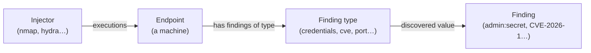
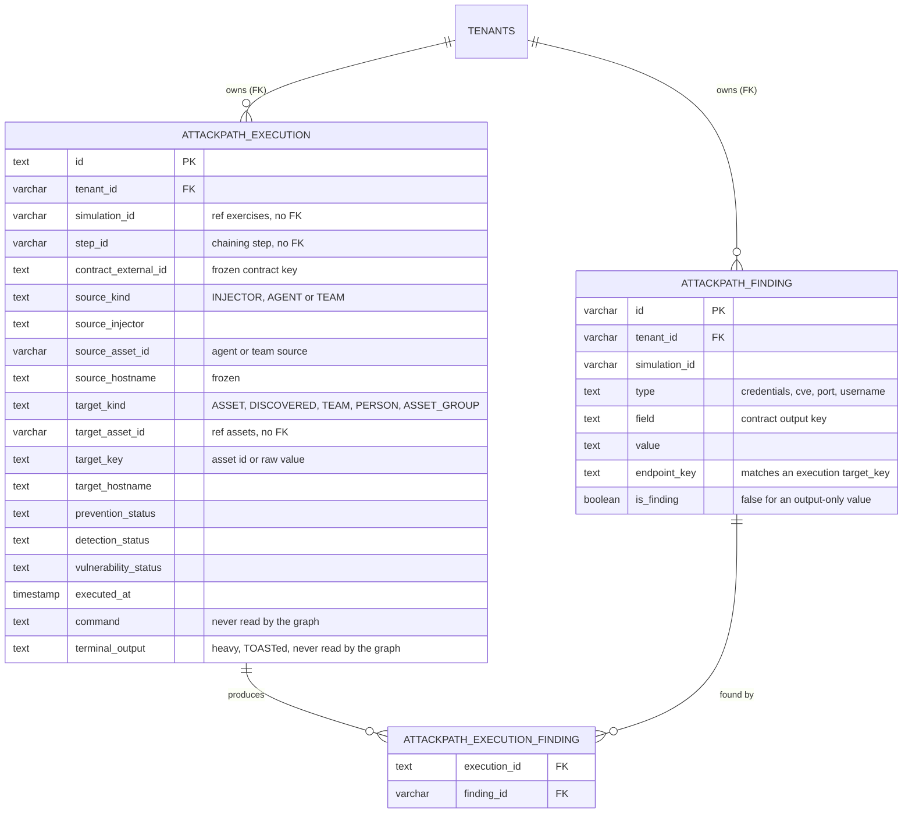
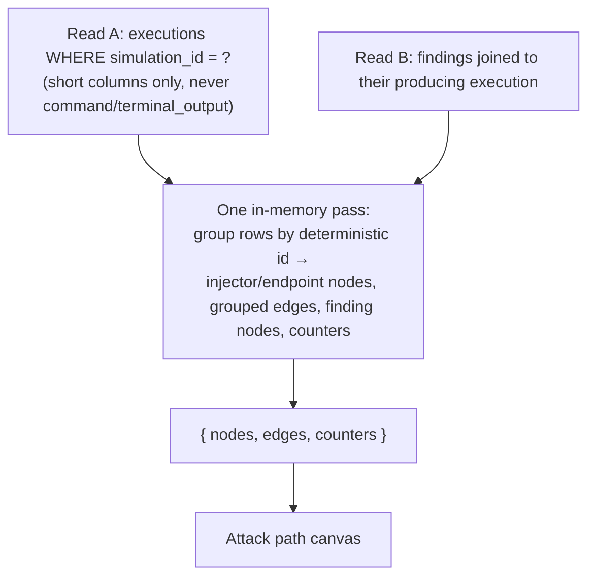
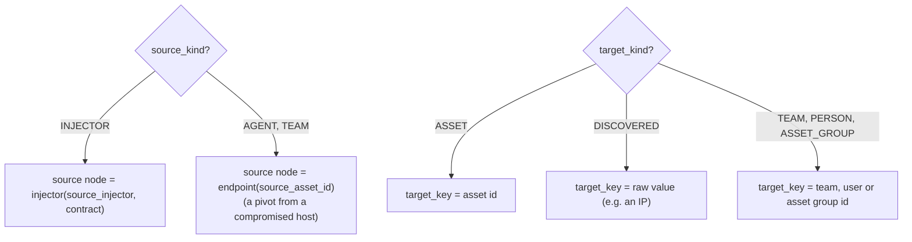
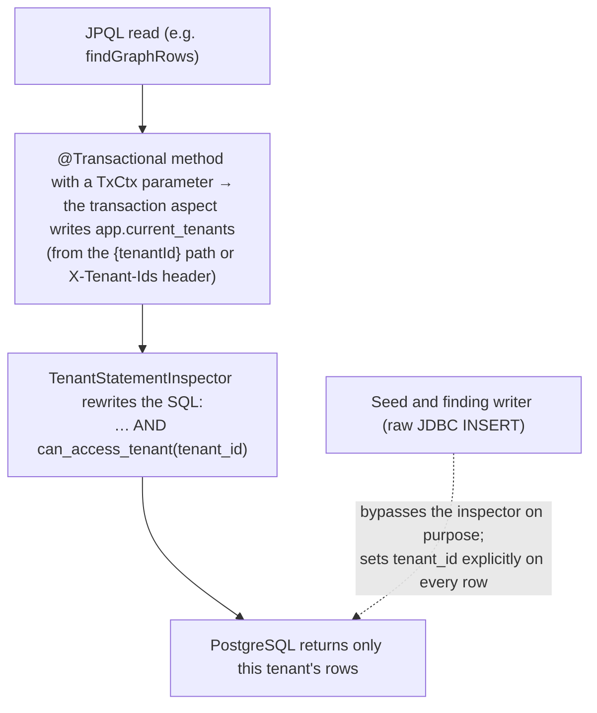
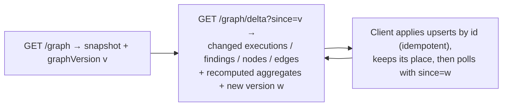

# Attack path

This page explains how the **Attack path** tab works for contributors: the data model, how the graph is rebuilt,
tenant isolation, the API, and how to seed and test it. For the product view, see
[Attack path map](../usage/attack-chaining/attack-path-map.md).

!!! note "Design records"

    The storage choice is in `adr/ADR-003-attack-path-execution-store-on-postgresql.md` and the output-based
    snapshot in `adr/ADR-004-attack-path-sourced-from-chaining-parsed-outputs.md`, at the repository root.

## The big picture

During a breach-and-attack simulation, **injectors** (tools such as `nmap`, `hydra`, `crackmapexec`)
run steps against **endpoints** (machines on the target network). Each step is an **execution**, and it
has an outcome — was it **prevented** (blocked) and was it **detected** (seen)? — and it may uncover
**findings**: credentials, CVEs, open ports, usernames.

The **attack path** view is the graph of all of that for one simulation: which injector hit which
endpoint, what each hit found, and how it chains. It is read as four left-to-right levels:



The rows are written by the Chaining Engine while a chained simulation runs. `InjectExecutionStep` calls
`AttackPathExecutionIngestionService.onRun` (one execution row per source → target edge), then on each
execution event syncs the expectation verdicts and calls `AttackPathFindingIngestionService.copyFindings` and
`copyOutputs` (output-only values, see ADR-004). These writes are non-fatal: a failure is logged and
never rolls the inject back. The terminal-output write (`updateTerminalView`) is not wrapped. Writes run in a
tenant-scoped transaction, `REQUIRES_NEW` except collector and terminal-output writes when none is open.

The tab only exists on chained simulations (with a workflow) and chained scenarios.

## The data model

Three tables hold the graph, all prefixed `attackpath_`. The key idea: **reference ids**
(simulation, asset, agent, contract) are stored as **plain columns frozen at execution time**, not
foreign keys to the live product tables. In these three tables the only foreign key to a product table is
`tenant_id`, which the tenant inspector enforces isolation through (see [Tenant isolation](#tenant-isolation)).

Most columns are prefixed with the table name (for example `attackpath_execution_simulation_id`); the diagram
shortens them. `tenant_id` and the link table's `execution_id` / `finding_id` have no prefix.



- **`attackpath_execution`** — one row is one **hop**: a source (an injector, or an agent on an already
  compromised asset) acting on a target endpoint. It carries a snapshot of the run (hostname, ip,
  platform, agent, prevention/detection/vulnerability status, payload), plus the heavy `terminal_output`
  text column that PostgreSQL stores off-row (TOAST) and a shorter `command` column — **neither is read by
  the graph** (Read A selects only the short display columns).
- **`attackpath_finding`** — one row is one `(endpoint, type, value)`: a thing discovered on an
  endpoint. `endpoint_key` matches an execution's `target_key`, which is how a finding attaches to an
  endpoint.
- **`attackpath_execution_finding`** — the many-to-many link that records **which execution produced
  which finding** (used to cross-reference the feed with the finding nodes).

Side tables complete the model:

- **`attackpath_graph_version`** — one monotonic counter per `(simulation, tenant)`, with a matching
  `row_version` column on the execution and finding tables. It drives the incremental read (see
  [Live updates](#live-updates-during-a-run-versioned-deltas)).
- **`attackpath_execution_collector`** and **`attackpath_execution_remediation`** — frozen collector results
  and detection remediations, read by the execution detail. The remediation table has a foreign key to
  `steps`.

Because the ids are a frozen snapshot, an endpoint renamed after the run keeps the name it had at execution
time.

## The rebuild: flat reads and one pass

The full graph is rebuilt from **two flat reads plus one in-memory pass**, then enriched by a fixed set of
batched reads (kill chain, contract names, ATT&CK techniques, inject statuses, asset criticality). No
recursion, and the number of statements does not grow with the graph (an auto-served request first runs
one cheap indexed `COUNT` to choose full vs collapsed).



- **Read A** (`findGraphRows`, a JPQL projection — JPQL is Hibernate's typed query language) becomes the
  **edges** (one grouped edge per `source → target`, carrying how many executions it groups) and the
  **injector** and **endpoint** nodes.
- **Read B** (findings joined to their execution) becomes the **finding** nodes, deduplicated by
  `(type, value)` so the same credential on two endpoints is one node.
- The **single pass** (`AttackPathGraphService.assemble`) turns the rows into `{ nodes, edges, counters }`.
  The counters (endpoints, credentials, users, CVEs, ports, shares, files) are accumulated **in that same
  pass** — no extra query.

An **execution is carried on the edge** (its `executionIds`), not drawn as its own node on the map.
The left-hand **feed** still lists every execution.

### Source and target resolution

A row's source and target depend on how the step ran. An injector scanning a machine and an agent
pivoting from an already-compromised machine produce different source nodes; a target can be a known
asset or a raw discovered value (an IP that is not a registered asset).



### Deterministic ids

Every node and edge id is computed **deterministically from its content** (`AttackPathIds`), so the two
reads and the in-memory pass can reference the same node without a lookup table, and the same input
always yields the same id (idempotent, collision-safe even when a value contains the delimiter).

| Node / edge | Derived from |
| --- | --- |
| injector node | `(injector name, contract external id)` — one node per contract |
| endpoint node | `target_key` |
| finding-type node | `(type, endpoint_key)` |
| finding node | `(type, value)`; the value is SHA-256 hashed for sensitive types |
| execution feed node | `(execution id, target_key, agent id)` |
| grouped execution edge | `(source node id, target node id)` |

## Two read modes: full and collapsed

- **Full** — the reads and in-memory pass above. Every endpoint, every finding, every execution.
- **Collapsed** — the graph is built entirely from **four DB aggregations** (`GROUP BY`): one endpoint
  node per `target_key`, grouped edges, and per-type / per-endpoint-type distinct finding counts. The
  per-execution and per-finding rows are **never materialized**; the front loads an endpoint's detail on
  click (the expand / relations reads).

Without a `mode`, a cheap indexed `COUNT` compares the execution count to
`openaev.attackpath.collapse-threshold` (`application.properties`, default 20000); above it the simulation is
served collapsed. `?mode=full` or `?mode=collapsed` forces a mode. The front always loads the collapsed graph,
and also loads the full graph for the causal view when the simulation has at most 20,000 executions.

## Severity colours (prevention + detection)

An endpoint and its edges are coloured by a **three-state severity** that combines both outcomes, worst
first:

- **GREEN** — prevented (blocked).
- **ORANGE** — detected but not prevented (seen, but it got through).
- **RED** — neither detected nor prevented (it went unnoticed — the worst case).

An endpoint takes the **worst-case** severity of the executions targeting it (`RED > ORANGE > GREEN`).
In full mode the service computes this per execution and folds to the worst; in collapsed mode the
`GROUP BY` counts, per endpoint, the executions that are RED and those that are ORANGE (null-safe: a
missing status counts as "not prevented" / "not detected"), and the worst non-zero bucket wins.

## Tenant isolation

Isolation is **not** written by hand in the queries. The `attackpath_*` tables are declared tenant-active
(`openaev.tenant.active-tables`), and every read goes through Hibernate, so the **statement inspector**
rewrites each query to add `can_access_tenant(tenant_id)` against the tenant scope of the request. See
[Tenant isolation](tenant-isolation.md) for the mechanism.



The crucial detail: each read endpoint declares a **`TxCtx` parameter**. That is what makes the
transaction aspect write the request's tenant scope into `app.current_tenants`; without it the scope
stays empty and the inspector **fails closed** (returns nothing) rather than leaking. This is proven
end-to-end by `AttackPathHttpIsolationTest` (owner sees its data, another tenant sees empty, a
scope-less read is empty although the rows exist).

`attackpath_execution_finding` is not tenant-active: it is filtered through the finding it joins.
`attackpath_graph_version` is not tenant-active either (its bump is an `INSERT ... ON CONFLICT`, which the
inspector cannot rewrite): every query on it filters on `tenant_id` itself (`AttackPathGraphVersionRepository`).

## The API

All endpoints live under `/api/attack-path` and the tenant-prefixed `/api/tenants/{tenantId}/attack-path`.
Per-simulation reads check `SIMULATION` read access in the method (`AttackPathAccessControl.assertCanReadSimulation`).

| Method & path | Returns |
| --- | --- |
| `GET /simulations?scenarioId=` | the simulations with attack-path data, with endpoint + execution counts (the picker), limited to readable ones |
| `GET /simulations/{id}/graph?mode=` | the `AttackPathDTO` (full or collapsed), carrying the graph's current `graphVersion` |
| `GET /simulations/{id}/graph/delta?since=` | what changed since a version — the incremental read (below) |
| `GET /simulations/{id}/endpoint/findings?ref=` | one endpoint's finding-type and finding nodes |
| `GET /simulations/{id}/endpoint/relations?ref=&page=&size=` | one endpoint's executions (paged, default 50, clamped to 200, with `totalExecutions`) and its grouped edges (whole) |
| `GET /simulations/{id}/findings?category=&page=&size=` | a page of a category's findings (`credentials`, `users`, `files`, `cves`) for the drawer, credentials masked |
| `GET /simulations/{id}/execution?ref=` | one execution's Result & Terminal detail (see below); 404 if not in the caller's simulation |
| `POST /seed` | admin-only; synthetic scale data (see [Seed demo data](#seed-demo-data)) |
| `POST /seed/causal?scenario=&footholds=&live=` | admin-only; creates a demo chained simulation |
| `POST /simulations/{id}/replay?footholds=` | admin-only; plays the next stage of a `live=step` ransomware demo |

`ref` is an endpoint's `target_key` (asset id or raw value), URL-encoded; the front reads it from the node's
`ref` field. The execution id is also passed as `ref`, because it can contain a backslash that the servlet
container rejects in a path.

The execution detail returns the command and output (credentials masked), ATT&CK techniques, payload detection
remediations, and `securityPlatforms` — the platforms that prevented or detected it, with their status and
alerts. `securityPlatforms` is empty without an active [Enterprise Edition](../administration/enterprise.md)
license; the panel then shows that attribution requires Enterprise Edition, not a negative verdict. The verdict
labels are the platform's expectation statuses — see
[expectation management](../usage/run-and-evaluate/expectations/expectations.md).

### Live updates during a run (versioned deltas)

While a simulation is running, the view **keeps itself up to date incrementally** instead of
re-downloading the graph. Each simulation's attack-path state carries a **monotonic version**
(`attackpath_graph_version`, bumped in the same transaction as every projection write, so version
order equals commit order); each projection row carries the version it was last written at.



!!! warning "Version rules for writers"

    `AttackPathVersionService` documents two rules: no bump outside a projection-write transaction, and no
    projection write without a bump in the same transaction. Break the second and a client can hold a version
    whose rows it was never sent. A bump published outside a transaction sends no stream event (it is dropped
    silently); clients catch up on the safety-net poll.

- The front loads one snapshot, then applies deltas as upserts keyed by stable id. Aggregates
  (endpoint `findingCounts`, edge `count`) are shipped whole, never as increments, so a replayed
  delta converges: `snapshot(v) + delta(v→w)` equals `snapshot(w)`. A single accumulated graph feeds
  both render modes.
- **What triggers a delta read.** Every version bump publishes an `attack-path-version` event on the
  platform's shared **SSE (server-sent events)** stream (`/api/stream`, the one long-lived connection the whole app already
  holds through `useDataLoader`), carrying `{simulation_id, version}` and nothing else. The view
  fetches on that event, debounced 300 ms. A safety-net timer polls every **45 s ± 10 %** while the
  stream is healthy, and every **3 s** (`DELTA_POLL_MS`) when it is not. Only one delta read is ever
  in flight; an event arriving during one queues a single follow-up.
- **The event is a nudge, never data.** It carries no graph state, so a lost, duplicated or reordered
  event cannot corrupt the client — the delta read remains the only source of truth. Delivery waits for
  the commit, so a client fetching on a nudge never observes a version lower than the announced one.
- Applying a delta preserves everything the user owns: pan/zoom, selection, highlights, expanded
  clusters, table sort, drawer search/page/scroll. Layout is recomputed only when the graph's shape
  moves.
- **Execution verdicts update live**: when prevention / detection / vulnerability expectation results
  land, they are written to the projection and bump the version, so a node's colour *and* status
  label change on the graph without a reload.
- A discreet **freshness chip** shows *Live*, *Reconnecting…* or *Run finished*. Polling **pauses while the
  browser tab is hidden** (one resync on return) and **stops** once the run is finished or canceled.
- A cursor the server cannot answer — unknown, too old, or from another simulation — comes back as
  `resyncRequired`, and the client silently reloads the snapshot; never a partial graph. The same
  happens when a delta would exceed `openaev.attackpath.delta-max-rows` (default 5000).
- **Authorization.** Graph data only comes from the per-request delta read (same
  `assertCanReadSimulation` and `TxCtx` scoping as the snapshot), so a revoked permission stops the data at
  the next fetch. Stream events are filtered per consumer on tenant equality and
  `AttackPathAccessControl.canRead`, through a permission cache, so an event can still arrive briefly after a
  permission is revoked. It carries no data.

!!! note "Upgrading an environment that already has attack-path data"

    The migration that adds the versioning (`V6_20260730213000000__Add_attackpath_graph_version`)
    creates two cursor indexes, on `attackpath_execution` and `attackpath_finding`. The build is not
    `CONCURRENTLY`, so on very large projection tables it takes the table's write lock for the
    duration and attack-path ingestion is briefly blocked. Upgrade **outside an active simulation
    window**. The row-version columns themselves are `NOT NULL DEFAULT 0` and need no backfill:
    existing rows read as version 0, which any `since = 0` delta includes.

## Seed, explore, test

### Start the front

Start the backend and the front (`cd openaev-front && yarn start`, the dev server runs on port 3001 and
proxies `/api` to the backend). The tab appears on chained simulations and chained scenarios.

### Seed demo data

!!! warning "Development only"

    The seed endpoints are development data generators, marked in the code to be removed before production.

**Causal demo (visible in the UI).** `POST /seed/causal` creates a real chained simulation under one tenant
and returns its id; open that simulation's **Attack path** tab. Call it on the tenant route.
`scenario` is `realistic` (default), `scaled`, `intrusion` or `ransomware`; `footholds` sizes the wider
scenarios (default 20). With `scenario=ransomware&live=step` the simulation starts empty, and each
`POST /simulations/{id}/replay` lands the next stage.

```bash
TENANT=2cffad3a-0001-4078-b0e2-ef74274022c3
TOKEN=<your openaev.admin.token>

curl -X POST "http://localhost:8080/api/tenants/$TENANT/attack-path/seed/causal?scenario=realistic" \
  -H "Authorization: Bearer $TOKEN"
```

**Scale data.** `POST /seed` writes synthetic simulations with batched raw JDBC. Pass your `tenantId`
(the single-tenant default is `2cffad3a-0001-4078-b0e2-ef74274022c3`); without it the rows go to synthetic
tenants you cannot see. The seed writes injector-sourced executions only; the agent pivot path is covered by
`AttackPathGraphServiceTest`.

| preset   | shape                                                   | ~rows   | seed time |
|----------|---------------------------------------------------------|---------|-----------|
| `smoke`  | 6 tiny simulations                                      | ~1k     | instant   |
| `nav`    | 1 simulation, ~100 endpoints (smooth to navigate)       | ~2k     | ~1 s      |
| `medium` | 20 simulations, 100–450 endpoints, one 100k outlier     | ~0.5M   | ~100 s    |
| `large`  | 80 simulations (volume-scaling comparison)              | ~2M     | minutes   |
| `full`   | ~200 simulations, the 100k/300k/500k outliers           | ~5.8M   | ~20 min   |

Use the `AttackPathBenchmark` harness (not the endpoint) for `full`.

```bash
curl -X POST http://localhost:8080/api/attack-path/seed \
  -H "Authorization: Bearer $TOKEN" -H "Content-Type: application/json" \
  -d "{\"preset\":\"medium\",\"seed\":7,\"tenantId\":\"$TENANT\"}"
```

The seed is reproducible: the same `seed` integer produces the same rows. Seeded simulation ids are
`ap-seed-<seed>-sim-<n>`; `sim-0` is the largest. They are not real simulations, so read them through the API.

!!! note "Raw JDBC writes (the inspector exception)"

    `AttackPathSeedService` and `AttackPathFindingWriter` write with batched, multi-row **raw JDBC** that
    bypasses the tenant inspector. This is safe: the inspector adds no guarantee to a plain
    `INSERT ... VALUES`, and both set `tenant_id` explicitly on every row. Each is allowlisted with
    `@AllowRawJdbc` and checked by `TenantNonOrmAccessArchTest`. Never use raw JDBC on the read path.

### Explore the graph

Open a chained simulation → the **Attack path** tab. The view is locked to that simulation; on a chained
scenario, a picker lists the scenario's runs and defaults to the most recent.

- **Click an endpoint** to lazy-load its findings and its executions (side panel), and to highlight its path.
- **Click a summary card** to open the findings drawer for that category.
- **Click a feed entry** to open the execution Result & Terminal panel.

### Run the tests

```bash
# backend (real PostgreSQL): the attack-path suite plus the arch rule
mvn -pl openaev-api test -Dtest="AttackPath*,TenantNonOrmAccessArchTest"

# front (from openaev-front): unit tests, typecheck, lint
yarn vitest run src/__tests__/actions/attack-path src/__tests__/admin/components/simulations/simulation/attack_path
yarn check-ts && yarn lint
```

The scaling benchmark is not a unit test; it is env-gated and run explicitly:

```bash
ATTACKPATH_BENCHMARK=true ATTACKPATH_BENCHMARK_PRESET=medium mvn -pl openaev-api test -Dtest=AttackPathBenchmark
```

## Performance

`AttackPathBenchmark` seeds realistic rows, times `buildGraph` per simulation size, and compares full and
collapsed. On the `full` preset (5.78M executions, 200 simulations, single run on a dev machine):

| outlier | full (p50, heap) | collapsed (p50, heap) |
| --- | --- | --- |
| 100k executions | 1.4 s, ~0.9 GB | 0.32 s, ~0 |
| 300k executions | 3.8 s, ~1.9 GB | 0.84 s, 8 MB |
| 500k executions | 6.3 s, ~3.2 GB | 1.2 s, 16 MB |

What this means for contributors:

- Read A never selects `command` or `terminal_output`: detoasting them doubled the 500k read.
- An endpoint expand is one index scan on a single `target_key` (`idx_ap_exec_sim_targetkey`), in milliseconds.
- Collapsed mode removes the heap and render cost, not the database scan: a very large simulation stays
  around a second even collapsed.

## Where the code lives

- Backend: `io.openaev.api.attackpath` (the controller), `io.openaev.service.attackpath` (rebuild,
  collapsed, delta, ids, seed), `io.openaev.service.attackpath.ingestion` (writes from the Chaining Engine),
  `io.openaev.database.model.attackpath` + `…repository.attackpath` (entities, projections, queries).
- Migrations: `V6_20260723160000000__Add_attack_path_tables` and the later `V6_*attackpath*` migrations.
- Front: `openaev-front/src/admin/components/simulations/simulation/attack_path/` (view, canvas, cards, live
  hook), `scenarios/scenario/attack_path/ScenarioAttackPath.tsx`, and `src/actions/attack-path/`.

## What's next?

- [Attack path map](../usage/attack-chaining/attack-path-map.md) -- How users read the Attack path tab
- [Tenant isolation](tenant-isolation.md) -- How the statement inspector scopes every read
- [Database migrations](database-migrations.md) -- How to add a Flyway migration
