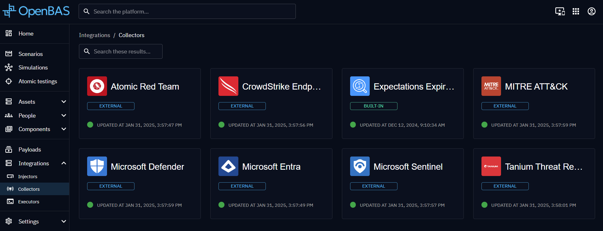

# Injector development

This page explains how to build an OpenAEV Injector to add new types of Injects to the platform. For a functional overview, see [Injectors](../integrations/injectors/injectors.md).

!!! note

    This page gives the big picture only. For a working example, read the code of the Filigran-maintained [HTTP Injector](https://github.com/OpenAEV-Platform/injectors/tree/main/http-query).

## How an Injector works with OpenAEV

An Injector is an independent process. It talks to OpenAEV through the REST API and a RabbitMQ queue, so you can write it in any language.

1. **Register.** The Injector sends `POST /api/injectors` as a multipart request: an `input` part with its `injector_id`, `injector_name`, `injector_type` and `injector_contracts`, and an optional PNG `icon` part. The response gives the RabbitMQ `connection` details and the queue to `listen` to: `<prefix>_injector_<injector_id>`, where the prefix is `openaev.rabbitmq.prefix` (`openaev` by default).
2. **Consume.** OpenAEV pushes each Inject to execute to this queue.
3. **Report.** The Injector sends the result with `POST /api/injects/execution/callback/{injectId}`, with at least `execution_message` and `execution_status`.

## How to implement an Injector

1. **Define one or more contracts.** A contract lists the fields of the Inject. OpenAEV uses it to build the Inject form in the UI, and the Injector uses it to read the values the user entered.
2. **Write the internal logic.** When the Injector receives an Inject, it reads the contract values and performs the action.

!!! note "Python-based Injectors"

    For Python, Filigran maintains the [`pyoaev` library](https://pypi.org/project/pyoaev/), with helper classes to build contracts.

## Run the Injector

Start the Injector process. It registers with OpenAEV and appears under **Integrations > Deployed**. Its contracts are then available when you create an Inject.

## What's next?

- [Deploy Injectors](../integrations/injectors/deploy-injectors.md) -- Deploy and configure an Injector
- [Collector development](collectors.md) -- Build a custom Collector
- [API usage](api-usage.md) -- Call the OpenAEV REST API
