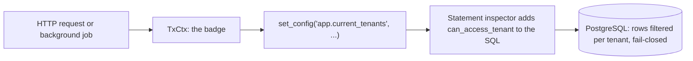
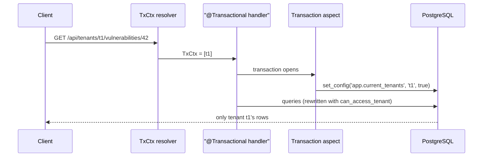
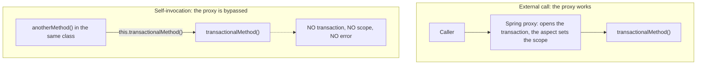
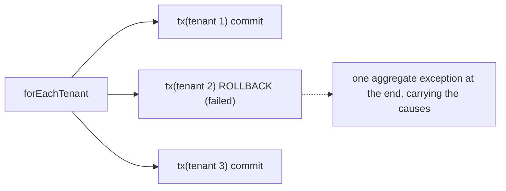

# Tenant isolation

OpenAEV can host several organizations, called tenants, in a single PostgreSQL database. The
security rule behind multi-tenancy is simple to state: a tenant must never see or modify another
tenant's data.

This page explains how the platform enforces that rule at the SQL layer, how a request or a
background job gets its tenant scope, and the rules to follow when your code touches an isolated
table.

!!! note "Who should read this"
    Anyone contributing to the OpenAEV backend. The most common mistakes fail silently by design.

## How isolation works

Think of the tenant scope as a badge. Every database transaction carries a badge that lists the
tenants it is allowed to see. The database checks the badge on every row of the activated tables.
No badge means no rows: the mechanism is **fail-closed**. When something is misconfigured, the
result is an empty result set rather than another tenant's rows.

Three components cooperate to make this work:

- **`TxCtx`** is the badge as a Java object. It says "this transaction may see tenants A and B".
  It is passed explicitly as a method parameter.
- **The transaction aspect** (`TenantScopeTransactionAspect`) fires when a `@Transactional`
  method runs. It reads the `TxCtx` parameter and writes the badge into the database with
  `set_config('app.current_tenants', ..., true)`. This setting is transaction-local: it disappears
  at commit.
- **The statement inspector** (`TenantStatementInspector`) rewrites every SQL statement that
  touches an isolated table, adding a call to the SQL function `can_access_tenant(tenant_id)`.
  The function compares each row's tenant with the badge. A row outside the badge is invisible.



Isolation is activated table by table. The list of isolated tables lives in the
`openaev.tenant.active-tables` property. A table that is not in the list is not rewritten.

## How an HTTP request gets its scope

A request can name the tenants it wants to work with in two ways:

- the tenant path: `/api/tenants/{tenantId}/...`
- the `X-Tenant-Ids` header on the regular path

If the request names no tenant, the scope defaults to every tenant the caller is a member of.
Naming a tenant outside the caller's memberships is refused with HTTP 403 (`TENANT_ACCESS_DENIED`).

The resolved scope becomes a `TxCtx` parameter on the controller handler. The argument resolver
(`TxCtxArgumentResolver`) builds it from the request; you never construct it yourself in a
controller:

```java
@Transactional
@GetMapping({
  VULNERABILITY_API + "/{vulnerabilityId}",
  TENANT_VULNERABILITY_API + "/{vulnerabilityId}"
})
@AccessControl(
    resourceId = "#vulnerabilityId",
    actionPerformed = Action.READ,
    resourceType = ResourceType.VULNERABILITY)
public VulnerabilityOutput getVulnerability(TxCtx ctx, @PathVariable String vulnerabilityId) {
  // ctx is not used here: the transaction aspect reads it
  return vulnerabilityMapper.toVulnerabilityOutput(
      vulnerabilityService.findById(vulnerabilityId));
}
```

The aspect runs before the RBAC check (`@AccessControl`), so the permission check already reads
under the tenant scope.



!!! warning "The TxCtx parameter looks unused. It is not."
    The handler body never touches `ctx`. The aspect reads it from the method arguments when the
    transaction opens. If a refactoring removes the parameter, the endpoint silently loses its
    scope and every query on an isolated table returns nothing. An architecture test
    (`TenantScopedEntrypointsTxCtxArchTest`) fails the build when a listed endpoint loses its
    `TxCtx`. The list is hardcoded: a new endpoint without `TxCtx` is not caught.

Two details matter here:

- The aspect only fires on `@Transactional` methods. A `TxCtx` parameter on a method without the
  annotation is ignored, and the endpoint stays fail-closed.
- Once a transaction carries a scope, a nested `@Transactional` call must not redefine it. The
  aspect refuses a different set of tenants inside the same transaction; the same set is accepted.

## How the SQL is rewritten

The inspector parses every statement that mentions an isolated table and adds the tenant check.
A `SELECT` gets its table wrapped in a filtered sub-query:

```sql
-- before
SELECT * FROM cwes WHERE cwe_external_id = ?
-- after
SELECT * FROM (SELECT * FROM cwes cwes WHERE can_access_tenant(cwes.tenant_id)) AS cwes
WHERE cwe_external_id = ?
```

An `UPDATE` or `DELETE` gets the check added to its `WHERE` clause. An `INSERT ... SELECT` into an
isolated table must set `tenant_id` explicitly, and the inserted value is validated against the
scope. Plain `INSERT ... VALUES` statements are not blocked: assigning the tenant of a new row is
the application's job (see the next section).

The rewriting is fail-closed too. When the inspector meets a SQL shape it cannot parse or does not
cover, it refuses the statement with a `TenantFilteringException` rather than letting it run
unfiltered. This has one practical consequence for contributors:

!!! warning "Native queries on isolated tables must be exercised by a test"
    Native queries written through Hibernate (`@Query(nativeQuery = true)`,
    `entityManager.createNativeQuery(...)`) DO go through the inspector. If your hand-written SQL
    uses a shape the rewriter does not support, the query will break loudly once the table is
    activated. Cover every native query on an isolated table with an integration test so this
    surfaces in CI, not in production.

Raw JDBC (`JdbcTemplate`, direct `Connection` usage) bypasses Hibernate, so the inspector never
sees it. Tenant data must be accessed through Hibernate (see `TenantNonOrmAccessArchTest` below).

## Writing data: one row, one tenant

Reading is filtered by the inspector. Writing needs one more step: a new row must be assigned to
exactly one tenant. The component responsible for this is `TenantWriteScopeResolver`:

```java
String tenantId = writeScopeResolver.tenantForWrite(ctx, null);
entity.setTenant(new Tenant(tenantId));
```

The resolver applies three rules:

- a single-tenant scope resolves to that tenant;
- a supplied tenant outside the scope is refused (HTTP 400);
- a multi-tenant scope with no explicit selector is refused (HTTP 400): the platform never guesses
  which tenant should own a new row.

!!! tip "Endpoints that must run in one tenant"
    Annotate the parameter as `@RequireTenantSelector TxCtx ctx`. Without a selector, a
    single-tenant caller resolves to its own tenant and a multi-tenant caller falls back to the
    default tenant. Only a multi-tenant caller without access to the default tenant gets HTTP 400
    (`TENANT_SELECTOR_REQUIRED`).

### The find-or-create trap

Isolated tables use per-tenant unique keys: two tenants may both own a row with the same business
key (for example, two tenants each have their own `CWE-79` row). This breaks a common pattern.
A find-or-create that looks up by the bare business key can match one row per tenant in scope,
which either crashes or silently links another tenant's row.

The correct order is always:

1. resolve the write tenant first: `tenantForWrite(ctx, null)` fails fast on an ambiguous scope;
2. look up by the per-tenant unique key, business key plus tenant
   (`findByExternalIdAndTenantId(key, writeTenant)`);
3. create the row with that same tenant if nothing was found.

## Background work: the transaction primitive

Background code (scheduled jobs, queue consumers, startup tasks) receives no HTTP request, so
nothing resolves a scope for it. It must not rely on `@Transactional` either, because of the Spring
self-invocation trap.

### Why `@Transactional` is banned in background code

Spring implements `@Transactional` with a proxy. When a method calls another `@Transactional`
method of the same class, the call skips the proxy: no transaction, no scope, and no error.



Background code therefore opens its transactions through an explicit object that cannot be
bypassed by accident: `TenantScopedTransaction`.

### The primitive

```java
tenantTx.execute(TxCtx.forTenant(tenantId), () -> {
    // the transaction is open AND the scope is set
    return repository.count();
});
```

The primitive has three entry points:

- `execute()` opens a top-level transaction. This is the normal door.
- `executeNew()` opens a nested `REQUIRES_NEW` transaction inside an existing one, to isolate a
  failure or narrow the scope on purpose.
- `setScopeOnCurrentTransaction()` sets the scope on a transaction the caller already opened,
  without opening one, so the work still sees that transaction's uncommitted rows. It has no
  nesting guard: it overwrites the current scope, to narrow it, widen it or switch tenants.

The primitive is strict on purpose:

| Guard | Behavior | Why |
|---|---|---|
| `execute()` and `forEachTenant()` refuse an already active transaction | exception | the primitive is a scope boundary, never a silent join |
| `executeNew()` and `setScopeOnCurrentTransaction()` refuse to run outside a transaction | exception | nesting must be a deliberate choice |
| `null` and `Missing` scopes are refused | exception | a scope-less transaction would read zero rows silently |
| the scope is set before any work runs | always | no query can run without the badge |

A `@Transactional` service called from inside the primitive joins its transaction (standard Spring
`REQUIRED` propagation) and keeps the scope. Existing services can be reused from background code
without changes when they take no `TxCtx` argument: the aspect then stays inert. A joined method
whose `TxCtx` holds a different set of tenants is refused, for example under
`execute(TxCtx.allTenants(), work)`.

Choosing the right method:

| Your situation | Use |
|---|---|
| one unit of work, one known tenant scope | `execute(ctx, work)` |
| the same unit of work for every active tenant | `forEachTenant(work)` (see below) |
| per-tenant work in parallel, on the job's own executor | one `execute(TxCtx.forTenant(id), work)` per task; concurrent scoped transactions are isolated from each other, and the job must await every task before returning |
| one global bulk job (read / delete / update by predicate) spanning all tenants in one shared transaction | `execute(TxCtx.allTenants(), work)` |
| isolate a failure, or narrow the scope, inside a running transaction | `executeNew(ctx, work)` |
| re-scope a transaction you joined but do not own, keeping its uncommitted rows visible | `setScopeOnCurrentTransaction(ctx)` |

Where does the tenant id come from in a job? Usually from the data the job processes (an entity
carries its tenant), from the message that triggered it, or from the per-tenant loop below, which
hands each iteration its tenant id.

### `allTenants()`: an intention, never a wildcard

Some jobs are global, such as a purge or an indexing pass. They run as one shared transaction with
`tenantTx.execute(TxCtx.allTenants(), work)`. `allTenants()` is an intention, not a badge: no
wildcard value ever reaches the database.

- Asking the intention for its badge value (`toGuc()`, the string written into the PostgreSQL
  setting) throws, so misuse on the HTTP path fails loudly.
- Only the primitive resolves it, at the moment the transaction opens, into the explicit list of
  active tenants. A long job that chains short transactions re-resolves at each one, so tenants
  created in between become visible.
- Write attribution refuses it: a new row cannot belong to "all tenants".

### The poisoning rule

Inside a background transaction, any runtime exception thrown by a joined `@Transactional`
service marks the whole transaction rollback-only. Catching the exception and carrying on does not
help: the final commit fails with `UnexpectedRollbackException` and everything is rolled back.

The practical rule: never catch-and-continue inside a single transaction. Recover around a
transaction boundary instead, either an `executeNew()` block (its `REQUIRES_NEW` transaction
isolates the failure) or one iteration of the per-tenant loop below.

### `forEachTenant`: the per-tenant loop

Most per-tenant jobs run a unit of work once for every active tenant, without letting one bad
tenant take the others down. The work receives the tenant id; rebuild the scope with
`TxCtx.forTenant()` when a called method needs it:

```java
tenantTx.forEachTenant(
    tenantId -> {
      // runs in its own top-level transaction, scoped to this tenant
      service.refreshSomething(TxCtx.forTenant(tenantId));
    });
```



A failing tenant is rolled back alone and cannot poison the others. Failures are collected and
rethrown as one aggregate exception at the end, never swallowed. Keep in mind:

- the tenant list is a snapshot taken when the loop starts; a tenant created mid-loop is picked up
  by the next run of the job;
- the loop is serial and single-threaded, and if some tenants failed, the job as a whole is
  reported failed even though the other tenants committed. Read the per-tenant log entries and the
  aggregate's suppressed causes to see what actually happened.

## Activating a table

Isolation is rolled out table by table. A table starts on the legacy mechanism (a Hibernate
`@Filter` driven by a thread-local tenant) and moves to the inspector-based mechanism described on
this page. Activating a table means, in one reviewed change:

1. every code path that touches the table carries a scope (a `TxCtx` on the HTTP side, the
   primitive on the background side);
2. new-row attribution is explicit where needed;
3. the legacy `@Filter` is removed from the entity;
4. the table name is appended to `openaev.tenant.active-tables`;
5. the build-time guards are extended for the new table.

The step-by-step runbook, with the eligibility gates, required tests and go-live checklist, is
`.claude/skills/activate-tenant-table/SKILL.md` in the repository.

The list of currently isolated tables is the value of `openaev.tenant.active-tables` in
`openaev-api/src/main/resources/application.properties`.

Several architecture tests detect regressions over time:

| Guard | What it protects |
|---|---|
| `TenantScopedEntrypointsTxCtxArchTest` | a listed endpoint cannot silently lose its `TxCtx` parameter |
| `TenantActiveTableAccessArchTest` | only reviewed classes may access an isolated table's repository or lazy-load it through an association; activating a table without extending the guard fails the build |
| `TenantNonOrmAccessArchTest` | no raw JDBC in production code outside `io.openaev.migration` unless the class opts out with `@AllowRawJdbc` and a reason: tenant data goes through Hibernate so the inspector sees it |
| `TenantBackgroundTransactionArchTest` | no self-invocation of `@Transactional` methods, no `@Transactional` or raw transaction plumbing in `io.openaev.scheduler.jobs`, and no `TenantScopedTransaction` on the HTTP path; existing violations are frozen in a committed baseline |
| `ScopeChannelSourceTripwireTest` | only the aspect and the primitive may write the scope channel (`set_config('app.current_tenants', ...)`) |

## The frozen baseline

`TenantBackgroundTransactionArchTest` freezes each of its four rules against a baseline file
committed under `openaev-api/src/test/resources/archunit_store/` (`stored.rules` maps each rule to
its file). Every line is a known, unfixed violation. The baseline may shrink, never grow. The store
is locked, so a test run cannot rewrite it.

Each entry is one of these risks:

- **Self-invocation from a non-transactional caller**: a live bug. No transaction and no scope:
  reads return zero rows, writes run unguarded.
- **Self-invocation inside an open transaction**: harmless today, but the inner annotation looks
  like a guarantee it does not give.
- **`@Transactional` or raw `TransactionTemplate` in a job**: the transaction never gets a tenant
  scope, so isolated-table queries inside it read nothing.

Rules to follow:

1. **Never call your own `@Transactional` method through `this.method()`.** Either drop the inner
   annotation, or move the method to another Spring bean and call it through injection.
2. **Background code never uses `@Transactional`, `TransactionTemplate` or
   `PlatformTransactionManager`.** It opens through `TenantScopedTransaction`, the only mechanism
   that also sets the tenant scope.
3. **A new violation fails the build.** Fix the code; never re-freeze the store to hide it. A merge
   from `main` can bring someone else's violation: check `git log` on the flagged method and report
   or fix it.
4. **A `StoreUpdateFailedException` means a recorded violation was fixed, renamed or moved.**
   ArchUnit counts a rename or move as solved plus new. Removing the line is a store write, so
   re-freeze in the same PR as the change.
5. **Shrink the baseline when you can.** No CI step forces it. When you touch a class that already
   has an entry, use `.claude/skills/reduce-tx-baseline/SKILL.md`: one class per PR, fix, test and
   re-freeze together.

## Testing

- The test configuration activates no table. An isolation test must activate its table itself,
  for example `@TestPropertySource(properties = "openaev.tenant.active-tables=import_mappers")`
  (see `ImportMapperHttpIsolationTest`).
- Tests around `TenantScopedTransaction` must not be `@Transactional`: `execute()` refuses an
  active transaction. `TenantScopedTransactionIntegrationTest` is the reference.

## Troubleshooting

**A query on an isolated table returns nothing, with no error.** This is the fail-closed design
telling you a scope is missing. Check, in order: is the handler `@Transactional`? Does it declare
a `TxCtx` parameter? On the background side, does the code open its transaction through
`TenantScopedTransaction`? A repository called outside any scoped transaction reads zero rows by
design.

**A native query fails with `TenantFilteringException` after a table was activated.** The
inspector refused a SQL shape it cannot rewrite safely. Rewrite the query into a covered shape;
never work around the inspector with raw JDBC.

**An HTTP 400 with `TENANT_WRITE_SCOPE` on a create or import.** The request tried to create a
row under an ambiguous multi-tenant scope. Use the tenant path (`/api/tenants/{tenantId}/...`) or
a single-tenant selector so the platform knows which tenant owns the new row.

**An HTTP 403 with `TENANT_ACCESS_DENIED`.** The tenant path or the `X-Tenant-Ids` header names
a tenant the caller is not a member of.

**An `UnexpectedRollbackException` at commit in a background job.** Something inside the
transaction threw and was caught. See the poisoning rule above: recover around an `executeNew()`
or a `forEachTenant` iteration, not inside the transaction.

## Key classes

| Class | Role |
|---|---|
| `io.openaev.context.TxCtx` | the scope (badge): `Missing`, `Restricted(list)` or the `AllTenants` intention |
| `io.openaev.context.TenantScopedTransaction` | the background primitive: `execute`, `executeNew`, `setScopeOnCurrentTransaction`, `forEachTenant` |
| `io.openaev.aop.TenantScopeTransactionAspect` | writes the `TxCtx` of a `@Transactional` method into `app.current_tenants` |
| `io.openaev.config.TxCtxArgumentResolver` | builds the controller `TxCtx` from the tenant path or the `X-Tenant-Ids` header |
| `io.openaev.config.TenantStatementInspector` | rewrites SQL, adds `can_access_tenant`, fail-closed on unknown shapes |
| `io.openaev.config.TenantWriteScopeResolver` | resolves the single tenant a new row belongs to |
| `openaev.tenant.active-tables` (property) | the list of isolated tables |

## What's next?

- [Multi-tenancy](../administration/multi-tenancy.md) -- How administrators create and manage Tenants
- [Database migrations](database-migrations.md) -- Write Flyway migrations
- [Platform development](platform.md) -- Set up and run the platform locally
